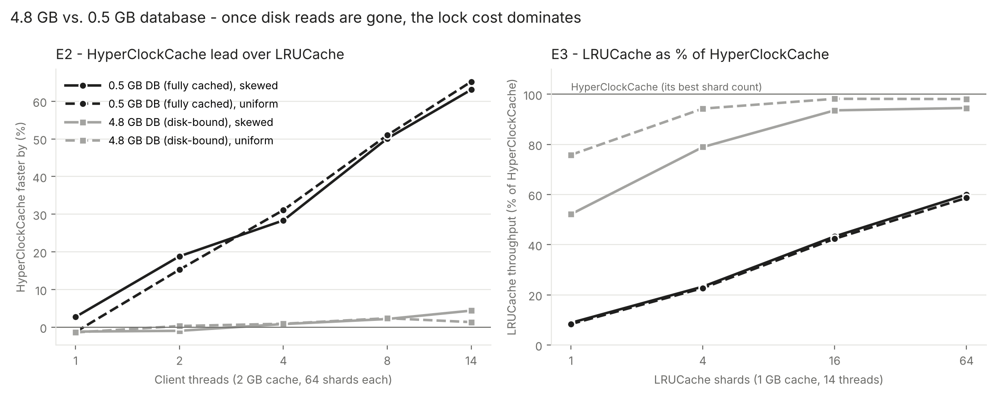
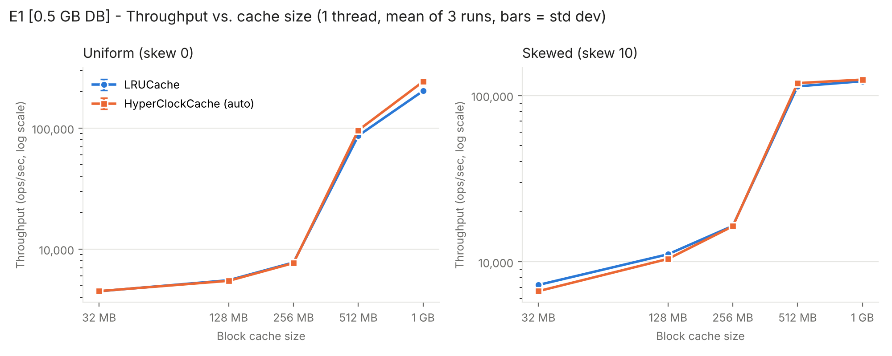
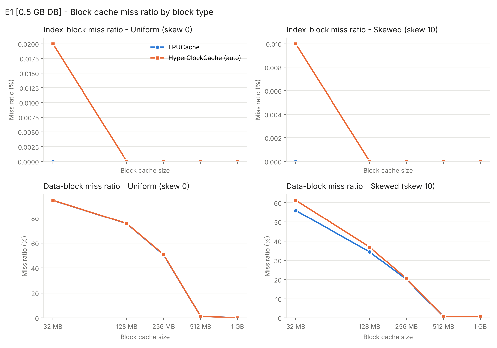
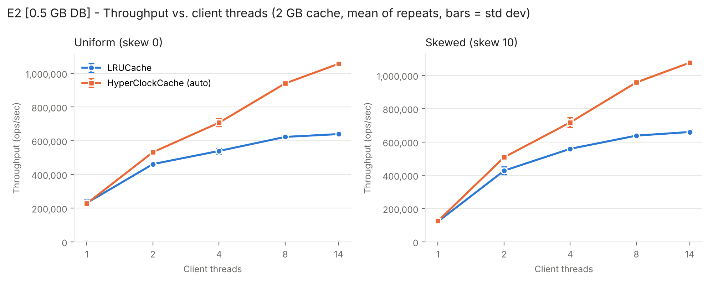
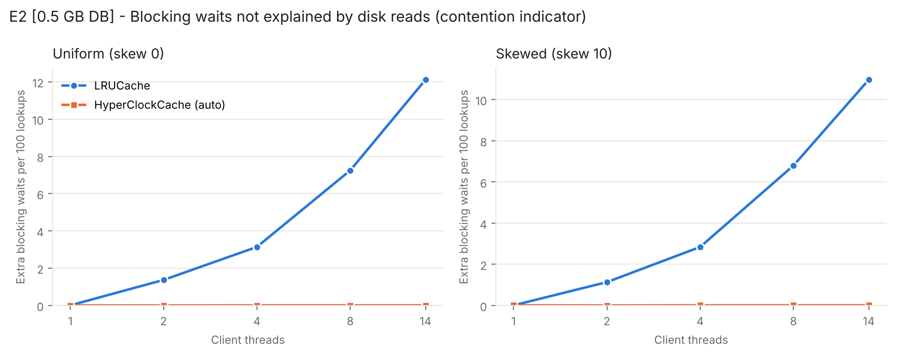
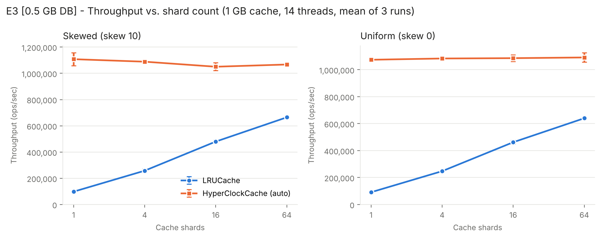
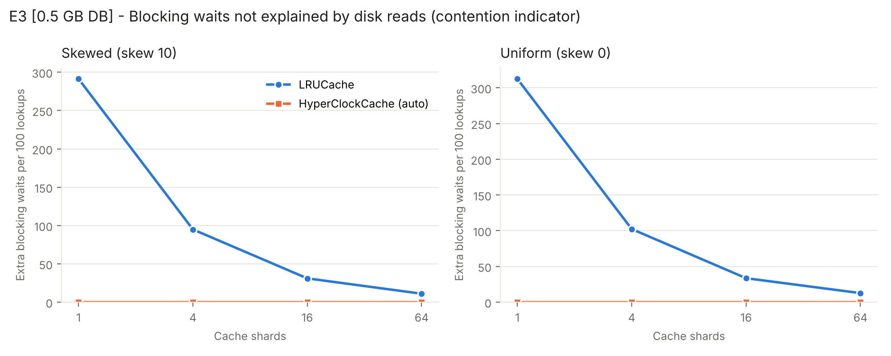
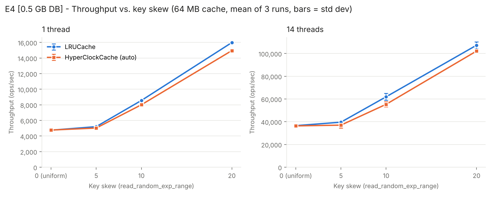
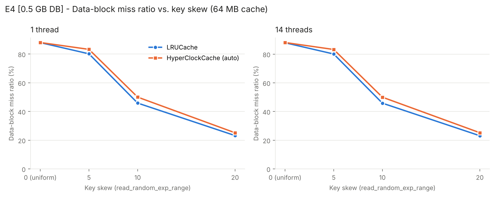

# HyperClockCache vs. LRUCache in RocksDB: fully cached rerun (0.5 GB database)

This branch repeats the comparison of RocksDB's two block caches on a **0.5 GB database that fits in the cache**, and adds a fourth experiment on key skew. The original study on the 4.8 GB database is described in the README on the `main` branch; its data and charts are kept here too, so the two can be compared.

**Author:** Aleksandra Basova, UMass Boston
**RocksDB version:** 11.8.1 (`db_bench`)

## Why a second database

In the main study the cache held only 20–40% of the 4.8 GB database, because the laptop has 7 GB of RAM. Most lookups therefore waited for a disk read (about 200–400 µs), which hides the cost of a lock wait. HyperClockCache's advantage in the main study (at most +4–6%) is therefore probably understated.

This rerun asks two questions:
1. **With the disk out of the picture, how much does HyperClockCache's lock-free design matter?** (E2, E3: the cache holds all the data.)
2. **When memory is tight, does LRUCache's smarter eviction still win?** (E1 at small cache sizes, and the new E4.)

## Key results

| Experiment | Setting | Result |
|---|---|---|
| **E1** cache size | 1 thread, 32 MB–1 GB | When the cache holds part of the data (32–256 MB), LRUCache is up to 9% faster with skewed keys, because it misses less often (56.0% vs. 61.3% data misses at 32 MB). With uniform keys the two tie. |
| **E2** threads | 2 GB cache (all data cached), 1–14 threads | HyperClockCache is **+63% (skewed) and +65% (uniform) faster at 14 threads**: about 1.07M vs. 0.65M ops/sec. LRUCache stops scaling after 8 threads. LRU threads block 11–12 extra times per 100 lookups, HyperClock threads 0.01. |
| **E3** shards | 1 GB cache (all data cached), 14 threads | With 1 shard, LRUCache runs at **9%** of HyperClockCache's speed (98k vs. 1.11M ops/sec). Even with 64 shards it reaches only 60%. HyperClockCache runs at the same speed with 1 to 64 shards. |
| **E4** skew (new) | 64 MB cache, skew 0, 5, 10, 20; 1 and 14 threads | Uniform keys: a tie. With any skew, LRUCache is 3–12% faster, **even at 14 threads**, because it keeps more of the hot blocks (45.9% vs. 50.0% misses at skew 10). |

**Answer:** The main study's answer holds, and the difference is much larger. When most lookups hit the cache and many threads run, HyperClockCache is 63–70% faster, because LRUCache's shard locks become the bottleneck. LRUCache wins, by 3–12%, only when the cache is small and the keys are skewed: then each extra miss costs a disk read, which is far more expensive than a lock wait.



## 4.8 GB vs. 0.5 GB at a glance

| Measure | 4.8 GB database (`main`) | 0.5 GB database (this branch) |
|---|---|---|
| Share of the data the cache holds in E2 and E3 | 20–40% | 100% |
| HyperClockCache lead at 14 threads, E2 (skewed / uniform) | +4.4% / +1.3% | **+63% / +65%** |
| LRU extra waits per 100 lookups at 14 threads, E2 skewed | 5.7 | 11.0 |
| E3, 1 shard, skewed: LRU vs. HyperClock (ops/sec) | 31k vs. 59k (LRU at 53%) | 98k vs. 1.11M (LRU at **9%**) |
| E3, LRU at 64 shards vs. HyperClock's best (skewed / uniform) | 95% / 98% | **60% / 59%** |
| Median lookup at 14 threads, E2 skewed (LRU vs. HyperClock) | 35 vs. 31 µs | 13.2 vs. 9.2 µs |
| p99.9 at 14 threads, E2 skewed (LRU vs. HyperClock) | 1,366 vs. 1,411 µs | **985 vs. 111 µs** |
| CPU per lookup at 14 threads, E2 skewed (LRU vs. HyperClock) | 65.5 vs. 60.1 µs | 16.3 vs. 11.1 µs |
| E1, 32 MB, skewed: LRU lead | +7.5% | +9.0% |
| E1, 32 MB, skewed: index-block misses (LRU vs. HyperClock) | 39% vs. 46% | about 0% for both |

What the comparison shows:
- **The amount of lock waiting barely changed; what changed is everything else.** With 1 shard (E3, skewed), LRU threads made about 300 extra waits per 100 lookups on both databases (304 and 291). On the 4.8 GB database, disk reads dominated the time anyway. On the 0.5 GB database, a cached lookup takes only about 9 µs, so the waits dominate.
- **Faster lookups mean more contention.** In E2 at 14 threads, LRU threads waited twice as often on the small database (11.0 vs. 5.7 per 100 lookups), because threads that are not waiting for the disk ask for the lock more often.
- **The tail shows it most.** p99.9 at 14 threads is 8–9× worse for LRUCache on the small database, while on the 4.8 GB database the tails were the same.
- **LRU's index protection only mattered on the big database.** The 0.5 GB database's index and filter blocks fit even in a 32 MB cache, so LRU's E1 lead here comes from keeping hot *data* blocks.

## Repository layout (this branch)

```
.
├── README.md                     this report (the 4.8 GB report is the README on main)
├── requirements.txt              Python packages for the analysis (pandas, matplotlib)
├── scripts/
│   ├── 00_build_rocksdb.sh, 01_build_database.sh, run_e1.sh … run_e3.sh, run_e2_rerun.sh   as on main
│   ├── bench.py                  changed: --num option (keys in the database), num_keys column
│   ├── 02_make_figures.sh        changed: also draws the *_small charts and the comparison
│   ├── 03_build_small_database.sh   new: generates the 0.5 GB database
│   ├── small_env.sh              new: settings shared by the small-database runs
│   ├── run_small_pilot.sh        new: short check before the long runs
│   └── run_small_e1.sh … run_small_e4.sh   new: E1–E4 on the 0.5 GB database
├── analysis/
│   ├── plot_e1.py … plot_e3.py   changed: also read the *_small files
│   ├── plot_e4.py                new
│   └── compare_dbs.py            new: 4.8 GB vs. 0.5 GB chart
├── data/
│   ├── results_e1.csv … results_e3.csv   4.8 GB runs (as on main)
│   ├── results_pilot_small.csv   2 pilot runs (not analyzed)
│   ├── results_e1_small.csv      60 runs
│   ├── results_e2_small.csv      60 runs
│   ├── results_e3_small.csv      48 runs
│   └── results_e4_small.csv      48 runs
├── results/
│   ├── e1_small_summary.csv …    means per configuration
│   ├── comparison_summary.csv    the numbers behind the comparison chart
│   └── figures/
│       ├── e1_plots … e3_plots   e*_ charts (4.8 GB) and e*_small_ charts (0.5 GB)
│       ├── e4_plots
│       └── comparison
└── docs/
    └── HCC_vs_LRU_report.pptx    presentation of the 4.8 GB results
```

## Setup

Everything is the same as on `main` except the number of keys:

| | 4.8 GB database (`main`) | 0.5 GB database (this branch) |
|---|---|---|
| Keys | 10,000,000 | 1,000,000 |
| Size on disk | 4.8 GB | about 0.5 GB |
| Platform, keys and values, LSM tree, blocks, direct I/O, cache options | same | same |
| Lookups per round | 200,000 to 1 million in total, split across the threads | 1,000,000 **per thread** when the data is cached; 200,000 when disk-bound (E4 at 14 threads: 100,000 per thread) |
| Master copy | `~/lsm_golden` | `~/lsm_small_golden` |

| Experiment | Varied | Held fixed |
|---|---|---|
| E1 | Cache 32, 128, 256, 512 MB, 1 GB (from about 6% of the data to twice the data) | 1 thread; LRU 64 shards, HyperClock 1 shard per 32 MB |
| E2 | Threads 1, 2, 4, 8, 14 | 2 GB cache, 64 shards for both |
| E3 | Shards 1, 4, 16, 64, **for both caches** (main: HyperClock only 1 and 4) | 1 GB cache, 14 threads |
| E4 | Skew (`read_random_exp_range`) 0, 5, 10, 20; 1 and 14 threads | 64 MB cache (about 13% of the data); LRU 64 shards, HyperClock 2 shards |

Skew 0 is uniform; higher values send more of the lookups to fewer keys. At skew 10, about 1% of the keys get 54% of the lookups.

## Method

The method is the same as on `main`:
- Each run executes `db_bench` twice on fresh copies of the master database: **A** (warm-up only) and **B** (warm-up, then measurement).
- Throughput and latency come from B's second round. Cache counters, CPU time and context switches are reported as **B − A**.
- **Extra blocking waits** = voluntary context switches − cache misses, per lookup. It counts how often threads wait on each other, not how long.
- 3 repeats per configuration; the mean is reported.

Checks that the rerun did what it was meant to:
- **Fully cached.** In E2 (2+ threads) and E3, the data miss ratio is 0.00%.
- **The contention measure still works.** At 1 thread, extra waits are 0.01 per 100 lookups for both caches.
- **Repeat consistency.** E3's LRU at 64 shards (665k ops/sec, skewed) matches E2's LRU at 14 threads (660k), which uses the same settings with a 2 GB cache.
- **No exclusions.** Every run is kept. One unusual run is described under Limitations.

## Results

### E1: cache size (1 thread)



The y-axis is logarithmic, because the fully cached sizes are up to 50× faster than the disk-bound ones.

- **32–256 MB (cache smaller than the data).** Most lookups wait for the disk (4,500–16,500 ops/sec).
  - Uniform keys: a tie, within 1–2%.
  - Skewed keys: LRUCache is +9.0% at 32 MB (7,258 vs. 6,659) and +6.6% at 128 MB (11,094 vs. 10,404); at 256 MB they tie.
  - The reason is the hit rate. Data misses at 32 MB are 56.0% vs. 61.3%, and at 128 MB 34.4% vs. 36.9%. LRU's high-priority pool keeps data blocks that were hit before, so hot blocks survive longer.
  - Unlike on the 4.8 GB database, index and filter misses are about 0 for both caches: the smaller tree's index and filter blocks fit even in 32 MB.
- **512 MB and 1 GB (cache about the size of the data, or larger).** Throughput jumps 7–30×.
  - With uniform keys HyperClockCache looks 11–19% faster (1 GB: 243k vs. 203k), but this is noise. E2 measured the same setting at 1 thread and found the opposite (LRU 231k vs. HyperClock 228k), and the HyperClock runs varied by 6%. With one thread there is no lock contention, so there is nothing for HyperClockCache to win.
  - With skewed keys, throughput at 1 GB (122–125k) is about half of uniform. About 0.64% of lookups still go to the disk: a skewed warm-up rarely touches the cold keys, so their blocks are never loaded, and each of those misses costs about 200 µs.



### E2: client threads (2 GB cache, all data cached)



| Threads | Uniform: LRU vs. HyperClock (ops/sec) | Skewed: LRU vs. HyperClock (ops/sec) |
|---|---|---|
| 1 | 230,750 vs. 227,828 | 122,021 vs. 125,346 |
| 2 | 461,496 vs. 532,018 | 427,677 vs. 508,177 |
| 4 | 539,341 vs. 707,115 | 558,923 vs. 717,413 |
| 8 | 622,685 vs. 940,081 | 638,126 vs. 957,833 |
| 14 | 639,399 vs. 1,056,201 (**+65%**) | 659,979 vs. 1,076,112 (**+63%**) |

- **Scaling.** From 1 to 14 threads, HyperClockCache gains 4.6×, LRUCache 2.8×. LRUCache is nearly flat after 8 threads (623k → 639k).
- **Contention.** At 14 threads, LRU threads make 12.1 (uniform) and 11.0 (skewed) extra waits per 100 lookups; HyperClock threads make 0.01.
- **Latency at 14 threads, uniform** (LRU vs. HyperClock): p50 13.7 vs. 9.3 µs, p99 146 vs. 28 µs, p99.9 931 vs. 114 µs. The slowest lookups are the ones that waited for a lock.
- **CPU per lookup at 14 threads, uniform:** 17.1 vs. 11.3 µs. LRUCache spends about 50% more CPU per lookup.
- **Skew hardly matters** once all the data is cached: the skewed and uniform curves are almost identical. The low skewed value at 1 thread is the cold-block effect described under E1.



### E3: shard count (1 GB cache, 14 threads, all data cached)



| Shards | LRU skewed | HyperClock skewed | LRU uniform | HyperClock uniform | LRU extra waits per 100 lookups (skewed / uniform) |
|---|---|---|---|---|---|
| 1 | 98,024 | 1,107,824 | 91,115 | 1,073,981 | 291 / 313 |
| 4 | 257,820 | 1,088,669 | 247,508 | 1,083,321 | 95 / 102 |
| 16 | 479,718 | 1,050,372 | 462,099 | 1,085,829 | 31 / 34 |
| 64 | 664,699 | 1,067,259 | 640,171 | 1,090,979 | 11 / 13 |

- **LRUCache depends on sharding.** Each 4× more shards cuts the extra waits by about 3× and raises throughput, but the gains shrink: 2.6× from 1 to 4 shards, 1.4× from 16 to 64. At 64 shards it still reaches only 60% of HyperClockCache.
- **HyperClockCache does not.** It runs at 1.05–1.11M ops/sec with any shard count, with 0.01 extra waits per 100 lookups. Its lookups take no lock, so splitting the cache does not help them.
- **LRU with 1 shard:** a median lookup takes 125 µs instead of HyperClock's 8.6 µs, and 86 µs of CPU instead of 11 µs, because all 14 threads queue on a single mutex.



### E4: key skew with a small cache (64 MB, new)



| Skew | Data misses at 1 thread (LRU vs. HyperClock) | 1 thread: LRU vs. HyperClock (ops/sec) | 14 threads: LRU vs. HyperClock (ops/sec) |
|---|---|---|---|
| 0 | 88.0% vs. 88.0% | 4,745 vs. 4,763 (tie) | 36,532 vs. 36,312 (tie) |
| 5 | 80.2% vs. 83.3% | 5,201 vs. 5,022 (LRU +3.6%) | 39,576 vs. 36,986 (LRU +7.0%, see note) |
| 10 | 45.9% vs. 50.0% | 8,560 vs. 8,009 (LRU +6.9%) | 61,918 vs. 55,309 (LRU +12%) |
| 20 | 23.2% vs. 25.2% | 15,987 vs. 14,954 (LRU +6.9%) | 107,272 vs. 102,129 (LRU +5.0%) |

Note: at skew 5 and 14 threads, one HyperClock run (repeat 3: 34,005 ops/sec, p99.9 2,497 µs) is 12% below the other two. Without it, LRUCache leads by 2.9%.

- **Uniform keys:** there are no hot blocks to protect, so both caches miss equally often and tie.
- **Skewed keys:** LRUCache misses 2–4 percentage points less, and since each miss is a disk read of about 200 µs, that decides throughput.
- **The median can flip.** At skew 10 and 1 thread, LRU's median lookup is 15 µs and HyperClock's is 144 µs. LRU's hit rate is just above 50% (54.1%) and HyperClock's is at 50.0%, so LRU's median lookup is a cache hit and HyperClock's is a disk read. Here the median shows which side of 50% the hit rate is on, not how fast the cache is.
- **Why LRU still wins at 14 threads:** LRU threads make only about 1 extra wait per 100 lookups here (HyperClock: 0.1–0.2), compared with 11 in E2. Threads spend most of their time waiting for the disk, so they rarely meet at a shard lock.



## Conclusions

1. **Disk time hid the lock cost.** At 14 threads, HyperClockCache's lead grew from 1–6% (4.8 GB) to 63–70% (0.5 GB).
2. **Sharding helps LRUCache but does not close the gap.** With 64 shards LRU is still 40% slower. HyperClockCache needs no shard tuning.
3. **Hit rate still decides when misses are common.** With a small cache and skewed keys, LRUCache is 3–12% faster at 1 and at 14 threads, because a disk read costs far more than a lock wait.
4. **Rule of thumb:** if most lookups hit the cache and several threads run, choose HyperClockCache. If the cache is small compared with the hot data, LRUCache's better hit rate matters more.

## Reproducing

```bash
# 1. Build db_bench (skip if already built for the main study)
bash scripts/00_build_rocksdb.sh

# 2. Build the 0.5 GB database (own folders; the 4.8 GB database is untouched)
bash scripts/03_build_small_database.sh

# 3. Pilot: checks the miss ratio is about 0 and the measured rounds last at least 5 s
bash scripts/run_small_pilot.sh

# 4. Run the experiments
bash scripts/run_small_e1.sh
bash scripts/run_small_e2.sh
bash scripts/run_small_e3.sh
bash scripts/run_small_e4.sh

# 5. Tables and charts (both databases, and the comparison)
bash scripts/02_make_figures.sh
```

The small-database scripts use `~/lsm_small_golden` (master copy) and `~/lsm_small_run` (per-execution copy). If the pilot shows rounds shorter than about 5 seconds, run with more lookups, for example `READS_CACHED=3000000 bash scripts/run_small_e2.sh`.

To run a single configuration on the small database:

```bash
LSM_GOLDEN=~/lsm_small_golden LSM_RUN=~/lsm_small_run \
python3 scripts/bench.py --exp E3 --num 1000000 --cache lru_cache --shard-bits 0 --cache-mb 1024 \
  --threads 14 --reads 1000000 --skew 10 --reps 3 --results results_e3_small.csv
```

Run nothing else on the machine during measurement, especially at 8 or more threads.

## Data dictionary

The columns are the same as on `main` (see its README), plus one:

| Column | Meaning |
|---|---|
| `num_keys` | Keys in the database: 1,000,000 for every `*_small` file. Added for this rerun, so the 4.8 GB files do not have it. |

`results_pilot_small.csv` holds the 2 pilot runs used to choose the round length. Some of its B − A counters are slightly negative (for example −10 misses), because with everything cached the counters are almost 0 and A and B differ by a few lookups. It is not used in the analysis.

## Limitations

- **Platform.** A laptop under WSL2, as on `main`. Compare the two caches with each other, not with absolute numbers from other systems.
- **Cold blocks with skewed keys at 1 thread.** A skewed warm-up never loads some cold blocks, so 0.64% of lookups still go to the disk at 1 thread (E1 at 512 MB and 1 GB, E2 at 1 thread). At 2+ threads the longer total warm-up loads them.
- **Single-thread, fully cached differences are noise.** E1 and E2 disagree on which cache is faster there.
- **One low E4 run** (HyperClock, skew 5, 14 threads, repeat 3) is kept in the mean and noted above.
- **Machine limit.** HyperClockCache's own scaling flattens from 8 to 14 threads (940k → 1.06M). This is likely the laptop's CPUs, shared with Windows and the benchmark itself, rather than the cache.
- **A smaller tree.** The 0.5 GB database has fewer LSM levels, so each lookup checks fewer filter blocks, and its index and filter blocks fit in every cache size. The index-protection effect seen in E1 on `main` cannot show up here.
- **Indirect contention measure.** Lock waits are counted, not timed. CPU time stands in for CPU cycles.
- **Not yet covered.** E4 on the 4.8 GB database, more than 64 LRU shards, more than 14 threads, scan workloads.
