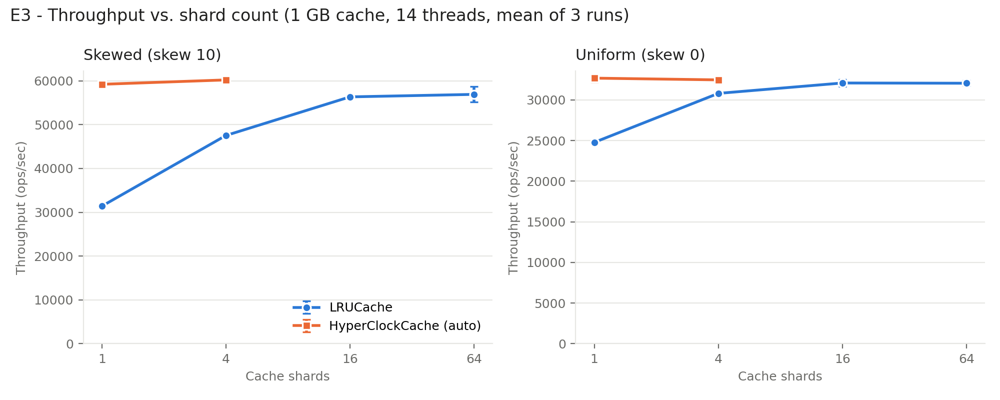

# HyperClockCache vs. LRUCache in RocksDB

A performance comparison of RocksDB's two block caches under varying cache size, client threads and shard count.

**Author:** Aleksandra Basova, UMass Boston

**RocksDB version:** 11.8.1 (`db_bench`)

## Question

**LRUCache is *smart*:**
- it keeps an exact LRU list per shard;
- it protects index blocks, filter blocks and already-reused data blocks in a high-priority pool;
- it takes a shard mutex on every access.

**HyperClockCache is *fast*:**
- it approximates recency with CLOCK counters (0-3);
- its priority handling is coarser;
- its lookups are lock-free.

**When does fast beat smart?**

## Key results

| Experiment | Setting | Result |
|---|---|---|
| **E1** cache size | 1 thread, 32 MB-2 GB | LRUCache is 0-10% faster. Its pool keeps index and filter blocks (index misses at 32 MB: 40% vs. 48%). |
| **E2** threads | 2 GB cache, 1-14 threads | HyperClockCache pulls ahead: +4.4% at 14 threads with skewed keys. LRU threads block about 50× more often (5.7 vs. 0.12 extra waits per 100 lookups). |
| **E3** shards | 1 GB cache, 14 threads | With 1 shard, LRUCache runs at half speed (31k vs. 59k ops/sec, 304 vs. 0.2 extra waits per 100 lookups). At its best (64 shards), LRU is still 5.8% slower, despite a slightly better hit rate (39.4% vs. 40.4% misses). |

**Answer:** HyperClockCache wins when many threads run and most lookups hit the cache. LRUCache wins when there is little parallelism or memory is tight.



## Repository layout

```
.
├── README.md
├── requirements.txt          Python packages for the analysis (pandas, matplotlib)
├── scripts/                  everything that runs on the test machine
│   ├── 00_build_rocksdb.sh   install tools, build db_bench 11.8.1 (release mode)
│   ├── 01_build_database.sh  generate the 4.8 GB database, keep a master copy
│   ├── bench.py              runs one configuration N times, appends rows to data/
│   ├── run_e1.sh             E1: cache size
│   ├── run_e2.sh             E2: thread scaling
│   ├── run_e2_rerun.sh       reruns 2 E2 settings disturbed by laptop activity
│   ├── run_e3.sh             E3: shard count
│   └── 02_make_figures.sh    rebuilds every table and chart from data/
├── analysis/                 plot_e1.py, plot_e2.py, plot_e3.py
├── data/                     raw results, one row per run (see "Data dictionary")
│   ├── results_e1.csv        48 runs (+1 smoke-test row, exp = "smoke")
│   ├── results_e2.csv        60 runs (3 excluded in analysis, see below)
│   └── results_e3.csv        36 runs
├── results/
│   ├── e1_summary.csv …      means per configuration
│   |── figures/              all charts
|       |── e1_plots
|       |── e2_plots
|       |── e3_plots
└── docs/
    └── HCC_vs_LRU_report.pptx           presentation of the results
```

## Setup

| | |
|---|---|
| Platform | Windows laptop, Ubuntu on WSL2 |
| CPU and memory | 14 cores, 7 GB RAM visible to Linux |
| Database | 10M keys from `filluniquerandom`, 64 B keys, 440 B values, 4.8 GB, no compression |
| LSM tree | Leveled, size ratio 2, 9 levels, 4 MB write buffer, 1 MB target file, 32 MB L1 |
| Blocks | 4 KB blocks, 10-bit Bloom filters, index and filter blocks in the block cache |
| I/O | Direct I/O for reads (no OS page cache) |
| LRUCache | `cache_high_pri_pool_ratio=0.5`; 64 shards (E1, E2) |
| HyperClockCache | `auto_hyper_clock_cache` (`estimated_entry_charge=0`); 1 shard per 32 MB (E1, E2) |
| Workload | `readrandom` point lookups, uniform keys or skewed keys (`read_random_exp_range=10`: about 1% of keys get 54% of reads) |
| Repeats | 3 per configuration, mean reported |

| Experiment | Varied | Held fixed |
|---|---|---|
| E1 | Cache 32 MB, 128 MB, 512 MB, 2 GB | 1 thread |
| E2 | Threads 1, 2, 4, 8, 14 | 2 GB cache, 64 shards for both |
| E3 | LRU 1, 4, 16, 64 shards; HyperClock 1, 4 shards | 1 GB cache, 14 threads |

## Method

Each **run** (one row in `data/`) executes `db_bench` twice. Each execution starts from a fresh hard-link copy of the master database, so each begins with an empty cache:

- **Execution A:** `--benchmarks=readrandom` (warm-up only)
- **Execution B:** `--benchmarks=readrandom,readrandom` (warm-up, then measurement)

Throughput and p50, p99 and p99.9 latency come straight from B's second round. RocksDB's cache counters and the OS's CPU and context-switch counts are cumulative per process, so for those the script reports **B − A**. Each warm-up issues at least two lookups per block the cache can hold, and never fewer than 200,000.

**Lock contention.** We measure contention as *extra blocking waits* = voluntary context switches − cache misses, per lookup:
- With direct I/O, every cache miss blocks the thread exactly once, on a disk read.
- Blocking beyond that is waiting on another thread.
- Check: with 1 thread the difference is 0 (0.6182 waits vs. 0.6181 misses per lookup).

This counts how *often* threads wait, not *how long*. Kernel tracing of lock wait time (`perf`, `bpftrace`) is not reliable under WSL2.

## Reproducing

```bash
# 1. Build db_bench 
bash scripts/00_build_rocksdb.sh

# 2. Build the database 
bash scripts/01_build_database.sh

# 3. Run the experiments
bash scripts/run_e1.sh
bash scripts/run_e2.sh
bash scripts/run_e3.sh

# 4. Tables and charts
bash scripts/02_make_figures.sh
```

The scripts expect `~/rocksdb/db_bench` and `~/lsm_golden`. To use other paths, set `DB_BENCH`, `LSM_GOLDEN` or `LSM_RUN`.

To run a single configuration:

```bash
python3 scripts/bench.py --exp E3 --cache lru_cache --shard-bits 0 --cache-mb 1024 \
  --threads 14 --reads 37449 --skew 10 --reps 3 --results results_e3.csv
```

Run nothing else on the machine during measurement, especially at 8 or more threads.

## Data dictionary (`data/results_*.csv`)

| Column | Meaning |
|---|---|
| `exp`, `rep` | Experiment label, repeat number (1-3) |
| `cache` | `lru_cache` or `auto_hyper_clock_cache` |
| `shard_bits` | Shards = 2^bits |
| `cache_mb` | Cache size in MB |
| `hipri` | LRU high-priority pool ratio (ignored by HyperClockCache) |
| `threads`, `reads_per_thread` | Client threads; lookups per thread in each round |
| `skew` | `read_random_exp_range`: 0 = uniform, 10 = skewed |
| `ops_sec` | Throughput of the measured round |
| `p50_us`, `p99_us`, `p999_us` | Latency percentiles, µs |
| `{data,index,filter}_{hit,miss}` | Block cache hits and misses, B − A |
| `*_miss_ratio` | misses / (hits + misses) |
| `cpu_us_per_op` | User + system CPU time per lookup, B − A |
| `misses_per_op` | All cache misses per lookup (E2, E3) |
| `vol_cs_per_op`, `invol_cs_per_op` | Voluntary / involuntary context switches per lookup (E2, E3) |
| `timestamp` | When the run finished |

## Limitations

- **Platform.** Laptop under WSL2. Compare the two caches with each other, not with absolute numbers from other systems.
- **Not fully cached.** The cache held only 20-40% of the 4.8 GB data, because 7 GB of RAM rules out a larger cache. Disk time therefore dilutes the lock cost, so HyperClockCache's advantage is probably understated.
- **Indirect contention measure.** Lock waits are counted, not timed. CPU time stands in for CPU cycles.
- **Excluded runs.** Three E2 runs are excluded in `analysis/plot_e2.py`: LRU, uniform keys, 1 thread (runs 1-2) and 4 threads (run 2). Their CPU time per lookup was 2-2.5× that of matching runs, which points to other activity on the laptop. `scripts/run_e2_rerun.sh` repeats those settings.
- **A result that did not reproduce.** E1 measured a 9.2% LRU lead at 2 GB, skewed. E2 repeated the identical setting and measured 1.2%. Miss counts matched exactly, so this was timing noise.
- **Not yet covered.** E4 (skew levels 0, 5, 10, 20 at 64 MB), scan workloads (scan resistance), other size ratios, tiered compaction.
